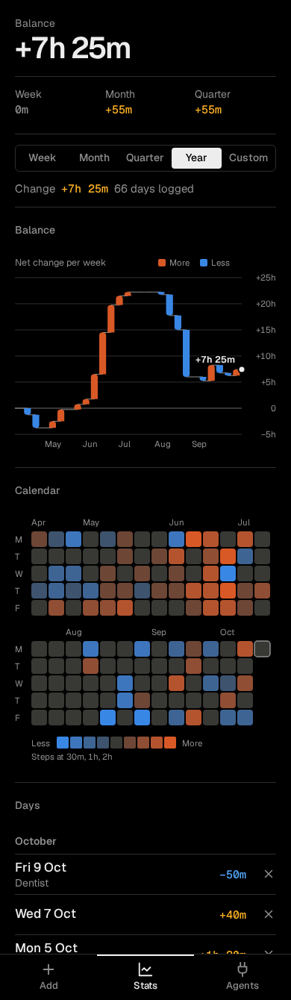
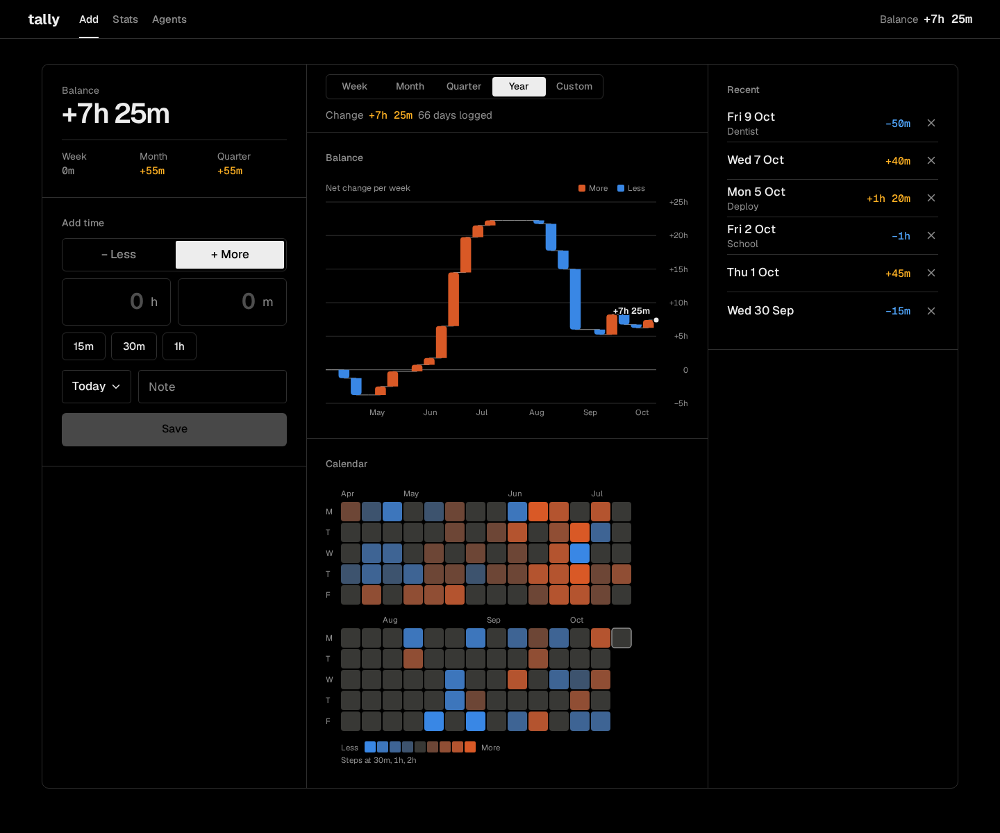

# tally design

Handoff for building tally. The look, the screens and the behaviour are settled. The stack, storage, auth and the MCP transport are not decided here.

## Product

tally tracks working time that differs from a normal day. You log only the days that were noticeably longer or shorter (15 minutes or more), and tally keeps a running balance.

1. **Add** from a phone in a few taps: more or less, how much, which day.
2. **Stats** show the balance and how it changed over time.
3. **Agents** read the data over MCP, so an AI agent has the context when it needs it.

## In this folder

| | |
|---|---|
| `reference/` | Clickable reference of the chosen design. HTML, CSS and plain JS, no build. Treat it as a spec, not as code to ship. |
| `screens/` | Screenshots of every screen on phone and desktop. |

Run the reference with `python3 design/reference/serve.py`, then open `localhost:3000`. The screens are `#today` (Add), `#balance` (Stats) and `#agents`. The sample data is in memory, today is fixed to Monday 12 Oct 2026, and everything resets on reload.

## Decisions

- **Outline** is the look. Black and white, hairlines, small radii, one ruled sheet on desktop. It was picked over six close variants and two earlier rounds.
- **Dark only** for now. No light mode, no theme setting.
- **Two charts.** A waterfall shows how the balance moved. A calendar shows the rhythm. A sloped line was rejected because the balance does not drift between entries, it jumps.
- **Calendar periods.** Week, Month, Quarter and Year mean this one so far, not the last 7, 30 or 90 days. Custom takes any two dates.
- **One period** scopes both charts, the change line and the Days list.
- **Undo, not confirm.** Saving and deleting act at once and offer Undo for 4 seconds.
- **Linear scale.** A big day may dwarf small ones in the Year view. Nothing is clipped or compressed. Month is the way to zoom in.
- **Polish comes later**, once the app is in daily use. Build to this spec and leave the small issues listed at the end until then.

## Data, as the reference behaves

- One entry per day: date, signed minutes against a normal day, optional note of at most 40 characters.
- Saving onto a day that has an entry adds to it. A new note replaces the old one, an empty note keeps it. An entry that reaches 0 is removed.
- Today and past days only. No future days.
- Balance is the sum of every entry up to today.
- The Week, Month and Quarter figures under the balance are the net change this week (from Monday), this month and this quarter, up to today.
- tally does not enforce the 15 minute threshold. It is the user's rule, and the quick amounts start at 15m.

## Screens

Phone: one column, tabs at the bottom (icon and word). Desktop, from 860px wide: a 56px top bar with the brand, the tabs as words with a 2px underline, and the balance on the right. Panels sit in one bordered sheet, max 1320px wide, with columns sharing hairlines. Layout follows the width of the app container, not the window.

| Screen | Phone, top to bottom | Desktop |
|---|---|---|
| **Add** `#today` | Balance, Add time, Recent | Balance and Add time on the left, the period and both charts in the middle. Recent sits under the form, or in a third column from 1180px. |
| **Stats** `#balance` | Balance with this Week, Month and Quarter, then period, Balance chart, Calendar, Days | Balance, period and both charts on the left, Days on the right |
| **Agents** `#agents` | Server and token, switch, Tools, Connected | Two columns |

## Tokens

### Colour

| Token | Value | Use |
|---|---|---|
| `bg` | `#000000` | Page, fields |
| `line` | `#2E2E2E` | Hairlines, field borders |
| `text` | `#EDEDED` | Text, selected controls, Save, toast |
| `muted` | `#8F8F8F` | Labels, headings, axis text |
| `more` | `#FFB224` | Positive amounts as text |
| `less` | `#52A8FF` | Negative amounts as text |
| `viz-more` | `#D95926` | Chart marks for more |
| `viz-less` | `#3987E5` | Chart marks for less |
| `viz-mid` | `#383835` | Normal day in the calendar |

Contrast on `bg`: text colours are 6.5:1 or better, chart colours 5.4:1 or better. The orange and blue pair passed a colour blindness check in an earlier round. Selected controls invert: `text` background with `bg` text. Colour is never the only signal. Amounts always carry a + or − sign.

### Type

- **Geist** for everything. **Geist Mono** for figures in running text: list amounts, the Week, Month and Quarter row, the change line, the top bar balance.
- Tabular numbers everywhere a number can change.
- Base 17px, line height 1.4.

| Role | Size and weight |
|---|---|
| Balance | 40px, 600, letter spacing −0.04em |
| Amount fields | 32px, 600, right aligned |
| Panel heading | 14px, 500, muted |
| Label | 14px, muted |
| Figures (mono) | 15px, 500. Top bar balance 17px, 600 |
| Save | 16px, 500 |
| Phone tabs | 13px, 500 |
| Chart text | 11.5px, captions 12.5px |

### Shape and space

- Radii: 6px for the direction and period controls, amount fields, chips and Save. 4px for the day, note and date fields, the server and token rows, and the period buttons. 2px for the direction buttons and Copy. 8px toast, 10px tooltip and the desktop sheet. The on and off switch is a full pill.
- Phone: 20px side padding, panels 22px top and bottom, divided by hairlines.
- Desktop: 40px side padding, 36px above the sheet, 28px inside panels.
- Height: amount fields 68px, day and note 48px, dates 44px, direction, chips and Copy 40px. The period buttons are only 28px, see Later.

## Components

- **Direction**: "− Less" and "+ More" as one two-way control, More selected by default.
- **Amount**: two large fields, hours and minutes, with a number keypad. Chips 15m, 30m and 1h add to the amount. Clear appears once there is an amount.
- **Day**: shows "Today" with a chevron and opens the native date picker. Past days only.
- **Note**: optional, one line, placeholder "Note".
- **Save**: disabled until there is an amount. The label carries the signed amount, "Save −1h 30m".
- **Toast**: "Saved −1h 30m" or "Deleted" with Undo. 4 seconds, with an 8ms haptic on both.
- **Lists**: date ("Today", "Fri 9 Oct") with the note under it, signed amount in `more` or `less`, × to delete. Days is grouped under month headings.
- **Period**: Week, Month, Quarter, Year, Custom, with Year selected at first. Five equal buttons that fill a phone and stop at 400px on a desktop. A period never starts before the first entry. Custom shows From and To dates, kept in order and inside the data. Under it: "Change +7h 25m  66 days logged".
- **Agents**: server address and token rows with Copy (shows "Copied" for 1.2 seconds). Switch "Let agents add time" changes the line to "Read and add, over MCP" and lists `add_day`. Tools: `get_balance` Balance now, `list_days` Days in a range, `get_trend` Balance by week, `add_day` Add time. Connected: agent, last tool, when.

## Charts

Both charts read the same period. Values never live only in a tooltip: the Days list is the table view of the same data.

### Waterfall, "Balance"

- One bar per day for periods up to 31 days, per week (from Monday) up to 32 weeks, otherwise per month.
- Each bar starts at the previous balance and ends at the new one. Orange for up, blue for down, no bar for no change.
- Bars are at least 2px tall and at most 24px wide, rounded 4px at the data end only.
- A thin muted line steps from bar to bar and ends at the right edge with a dot and the current balance.
- Y axis on the right with round steps from 15m to 80h, at most 6 intervals, 0 always included and drawn stronger.
- X labels at month starts, or Mondays when showing days. Caption "Net change per week" (or day, or month) with a More and Less key.
- Readout on hover, tap or arrow keys: Week 41 with its dates, Balance, Change, "+2h and −1h" when a bin has both, and the note for a single day. Other bars dim to 40%.

### Calendar

- One cell per day, weeks as columns, Monday first. Weekends are hidden unless the period has a weekend entry.
- Grey is a normal day. Four steps toward each colour, at 30m, 1h and 2h. The steps mix `viz-mid` toward the colour at 34, 56, 78 and 100% in OKLab.
- Cells are 8 to 28px. Long periods wrap into bands of weeks rather than shrinking, which keeps a cell around 21px on a phone.
- Today has a ring. Month names above, M T W T F at the side, then a Less to More key and "Steps at 30m, 1h, 2h".
- Readout: the day, More or Less with the amount (or "Normal day"), the note, and the balance that day.

## Formatting and copy

- Amounts: `+1h 30m`, `−45m`, `+2h`. The minus is U+2212. Zero is `0m`.
- Dates: "Today", otherwise "Fri 9 Oct". Week numbers are ISO weeks.
- Copy is short and plain. Prefer a single word or an icon to a sentence. Sentence case. No `;`, `:` or `-` unless the text needs it. An action keeps its name in its result: Save, Saved. Copy, Copied.

## Motion and access

- The balance counts to its new value in 15 minute steps over 420ms. The toast fades and rises 12px. Tooltips fade in 0.1s. The switch slides. That is all, and reduced motion turns it off.
- Focus ring: 2px in `text`, offset 2px.
- Direction is a radiogroup, the period buttons use aria-pressed, the switch is role="switch". Charts are role="img" with a label, take focus, and step with the arrow keys. Escape closes the readout.

## Later

Polish to do once tally is in daily use.

- The switch knob is white on an `#EDEDED` track when on, about 1.2:1. Give it a dark knob.
- The period buttons are 28px tall, small for a thumb. Make them at least 40px on phones. At 320px wide the labels nearly touch.
- Week is sparse early in the week. On a Monday the calendar shows a single cell. Showing the rest of the period as empty days may read better.
- The minutes field accepts 3 digits, so "90m" stays as typed instead of becoming "1h 30m".
- Not tested on a real phone yet, including the native date pickers.

## Not designed yet

- First run with no data, sign in, and adding or revoking an agent token.

## Only in the reference

- The fixed date, the sample data, the server address, the token and the connected agents. In the sample data Month and Quarter match, because the quarter began on 1 Oct.
- Fonts load from Google Fonts. Self-host them in the app.
